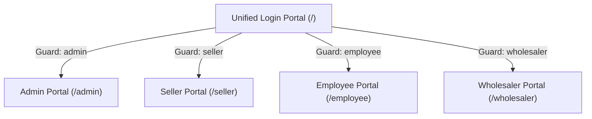

# Terra Pure

<p align="center">
  
</p>

<p align="center">
  <strong>Enterprise Multi-Role eCommerce, Distribution & ERP Platform</strong>
</p>

<p align="center">
  <a href="https://laravel.com"></a>
  <a href="https://php.net"></a>
  <a href="https://www.mysql.com/"></a>
  <a href="https://vitejs.dev/"></a>
  <a href="LICENSE"></a>
</p>

---

## 📖 Overview

**Terra Pure** is a comprehensive, multi-tiered eCommerce, Wholesale Distribution, and Supply Chain ERP platform built with **Laravel 10**. Designed to streamline end-to-end commerce operations, Terra Pure integrates multi-guard role authentication, supplier inventory tracking, multi-tier seller fulfillment, wholesale bulk ordering, financial commission calculation, courier logistics integration (Curfox API), and multi-channel payment processing.

---

## 📑 Table of Contents

- [Core Portals & User Roles](#-core-portals--user-roles)
- [Key Features & Modules](#-key-features--modules)
- [Technology Stack](#-technology-stack)
- [System Requirements](#-system-requirements)
- [Installation & Setup](#-installation--setup)
- [Default Login Credentials](#-default-login-credentials)
- [Environment Configuration](#-environment-configuration)
- [Directory Structure](#-directory-structure)
- [Useful Commands](#-useful-commands)
- [Contributing & License](#-contributing--license)

---

## 👥 Core Portals & User Roles

Terra Pure implements dedicated authentication guards and specialized dashboard interfaces for four distinct business roles:



### 1. 🛡️ Administrator Portal (`/admin`)
- **System Dashboard**: Real-time sales KPIs, revenue summaries, order volume analytics, and performance charts.
- **Master Catalog**: Full lifecycle management of Products, Categories, Brands, and Suppliers.
- **Inventory & Stocks**: Centralized warehouse inventory control, batch logging, and stock movements.
- **User Management**: Control administrator accounts, employee assignments, and permissions.
- **Seller & Wholesaler Management**: Onboarding, profile verifications (NIC documents), status toggling (Active/Pending/Suspended).
- **Financial & Commission Oversight**: Commission distributions, wallet adjustments, and withdrawal approvals.
- **Reporting & Exports**: Invoice printing, PDF dispatch slips (`DomPDF`), and Excel spreadsheet exports (`Maatwebsite Excel`).

### 2. 💼 Seller Portal (`/seller`)
- **Dual Seller Models**: Supports both **System Sellers** (company-managed fulfillment) and **Self Sellers** (merchant-managed fulfillment).
- **Shop & Catalog Management**: Manage seller shops, assigned categories, and custom product catalogs.
- **Order Processing**: Live order lifecycle tracking, customer call logging, and delivery status updates.
- **Automated Courier Dispatch**: Integrated with the **Curfox API** (Royal Express) for instant parcel creation, waybill generation, and tracking.
- **Wallet & Earnings**: Track commission balances, security deposit reserves, sales revenues, and payout records.

### 3. 👔 Employee / Operations Portal (`/employee`)
- **Order Picking & Verification**: Staff order selection queues, packing verification, and delivery call workflows.
- **Wholesaler Approval Workflow**: Review and approve newly submitted wholesale products, price updates, and inventory changes.
- **Exchange & Return Management**: Inspect and process wholesale return/exchange requests with validation checks.
- **Seller Product Approvals**: Quality inspection for seller-submitted product listings before going live.

### 4. 📦 Wholesaler Portal (`/wholesaler`)
- **B2B Bulk Catalog**: Exclusive wholesale product catalogs with tiered volume pricing and minimum order quantities (MOQ).
- **Bulk Ordering**: Streamlined B2B cart, bulk purchase orders, and wholesale invoice generation.
- **Product Exchange Claims**: Submit and track replacement requests for damaged or exchanged stock.
- **Multi-Channel Payments**: Online payments via **Stripe** and **PayPal**, as well as offline bank deposit slip uploads.

---

## ⚡ Key Features & Modules

- **Multi-Guard Authentication**: Powered by Laravel session guards (`admin`, `seller`, `employee`, `wholesaler`, `web`) with unified login routing.
- **Curfox Courier Logistics**: Automated integration with the Curfox / Royal Express courier API for real-time waybill booking, origin city routing, and order tracking.
- **Multi-Gateway Payment Processing**:
  - **Stripe**: Embedded card payments and automated webhook processing (`/webhook/stripe`).
  - **PayPal**: PayPal REST API SDK integration for fast checkout.
  - **Direct Bank Transfer**: Bank slip upload and manual review workflow.
- **Invoicing & Documents**: Automated PDF invoice generation, order print logging (`OrderPrintLog`), and barcode support.
- **Security & Activity Tracking**: Session activity tracking via `LastUserActivity` middleware, hashed password encryption, and NIC verification for sellers.

---

## 🛠️ Technology Stack

| Component | Technology / Library |
|---|---|
| **Framework** | [Laravel 10.x](https://laravel.com/) |
| **Language** | PHP `^8.1` or `8.2` |
| **Database** | MySQL / MariaDB (InnoDB engine) |
| **Frontend Assets** | [Vite 5](https://vitejs.dev/), JavaScript (ES Modules), CSS |
| **UI Components** | SweetAlert2, Axios, Bootstrap / Blade templates |
| **PDF Generation** | [barryvdh/laravel-dompdf](https://github.com/barryvdh/laravel-dompdf) |
| **Spreadsheets** | [maatwebsite/excel](https://github.com/SpartnerNL/Laravel-Excel) |
| **Payment Gateways** | [stripe/stripe-php](https://github.com/stripe/stripe-php), [paypal/rest-api-sdk-php](https://github.com/paypal/PayPal-PHP-SDK) |
| **Logistics Integration** | Curfox Merchant REST API |

---

## 📋 System Requirements

Ensure your server or local environment meets the following specifications:

- **PHP**: `^8.1` or `^8.2`
  - Required PHP Extensions: `BCMath`, `Ctype`, `cURL`, `DOM`, `Fileinfo`, `GD`, `JSON`, `Mbstring`, `OpenSSL`, `PCRE`, `PDO`, `pdo_mysql`, `Tokenizer`, `XML`
- **Composer**: `>= 2.2`
- **Node.js**: `>= 18.x` & **NPM** `>= 9.x`
- **Database Server**: MySQL `8.0+` or MariaDB `10.4+`
- **Web Server**: Apache, Nginx, or Laravel built-in server

---

## 🚀 Installation & Setup

### 1. Clone the Repository
```bash
git clone https://github.com/your-username/terra-pure.git
cd terra-pure
```

### 2. Install Dependencies
```bash
# Install PHP dependencies
composer install

# Install Frontend dependencies
npm install
```

### 3. Environment Configuration
Copy the sample environment file and generate a secure application key:
```bash
cp .env.example .env
php artisan key:generate
```

Open `.env` and configure your database and app settings:
```ini
APP_NAME="Terra Pure"
APP_ENV=local
APP_DEBUG=true
APP_URL=http://127.0.0.1:8000

DB_CONNECTION=mysql
DB_HOST=127.0.0.1
DB_PORT=3306
DB_DATABASE=terra-pure
DB_USERNAME=root
DB_PASSWORD=
```

### 4. Run Migrations & Seed Database
Ensure your MySQL server is running, then run the database migrations and seed default credentials:
```bash
php artisan migrate
php artisan db:seed
```

### 5. Link Public Storage
```bash
php artisan storage:link
```

### 6. Build Frontend Assets
```bash
# For local development with HMR
npm run dev

# Or build for production
npm run build
```

### 7. Run the Application
```bash
php artisan serve
```

Visit the application at: **[http://127.0.0.1:8000](http://127.0.0.1:8000)**

---

## 🔑 Default Login Credentials

After executing `php artisan db:seed`, use the default credentials below to access the administrative dashboard:

| Role | Portal URL | Username | Password |
|---|---|---|---|
| **System Administrator** | `http://127.0.0.1:8000/` (Redirects to `/admin`) | `admin` | `admin123` |

> [!NOTE]  
> New **Sellers**, **Employees**, and **Wholesalers** can be created through the Administrator dashboard or registered through their respective onboarding forms.

---

## ⚙️ Environment Configuration

Key `.env` environment variables used across the application:

```ini
# Application
APP_NAME="Terra Pure"
APP_ENV=local
APP_KEY=base64:...
APP_URL=http://localhost:8000

# Database
DB_CONNECTION=mysql
DB_HOST=127.0.0.1
DB_PORT=3306
DB_DATABASE=terra-pure
DB_USERNAME=root
DB_PASSWORD=

# Curfox Courier Integration (Royal Express)
# Configured in app/Services/Curfoxapiservice.php

# Payment Gateways (Stripe & PayPal)
STRIPE_KEY=your_stripe_publishable_key
STRIPE_SECRET=your_stripe_secret_key
STRIPE_WEBHOOK_SECRET=your_stripe_webhook_secret

PAYPAL_CLIENT_ID=your_paypal_client_id
PAYPAL_SECRET=your_paypal_secret
PAYPAL_MODE=sandbox # or live
```

---

## 📁 Directory Structure

```plaintext
terra-pure/
├── app/
│   ├── Http/
│   │   ├── Controllers/
│   │   │   ├── Admin/          # Admin-specific controllers (Dashboards, analytics)
│   │   │   ├── Employee/       # Employee order selection, approvals & delivery calls
│   │   │   ├── Seller/         # Seller shops, catalogs, delivery tracking & calls
│   │   │   ├── Wholesaler/     # Wholesaler orders, products, payments & exchanges
│   │   │   ├── AdminController.php
│   │   │   ├── LoginController.php
│   │   │   ├── ProductController.php
│   │   │   └── ...
│   │   └── Middleware/         # Custom route guards and activity trackers
│   ├── Models/                 # Eloquent Models (User, Admin, Saler, Wholesaler, Product, etc.)
│   └── Services/               # Third-party integrations (Curfoxapiservice, Storage, Code Generators)
├── config/                     # Application configurations (auth, database, excel, dompdf)
├── database/
│   ├── migrations/             # Database schema migrations
│   └── seeders/                # Database seeders (DatabaseSeeder.php)
├── public/                     # Public web assets (css, js, images, uploads)
├── resources/
│   ├── views/                  # Blade templates (admin, seller, employee, wholesaler, login)
│   ├── css/
│   └── js/
├── routes/
│   ├── web.php                 # Web routes grouped by auth guards
│   └── api.php                 # API endpoints & webhooks
└── storage/                    # File storage, uploads, generated PDF invoices & logs
```

---

## 💻 Useful Commands

```bash
# Clear all application caches
php artisan optimize:clear

# Cache configuration, routes, and views for production
php artisan optimize

# View all registered routes
php artisan route:list

# Re-run migrations and seed fresh data
php artisan migrate:fresh --seed
```

---

## 📄 License

This software is licensed under the [MIT License](LICENSE).
